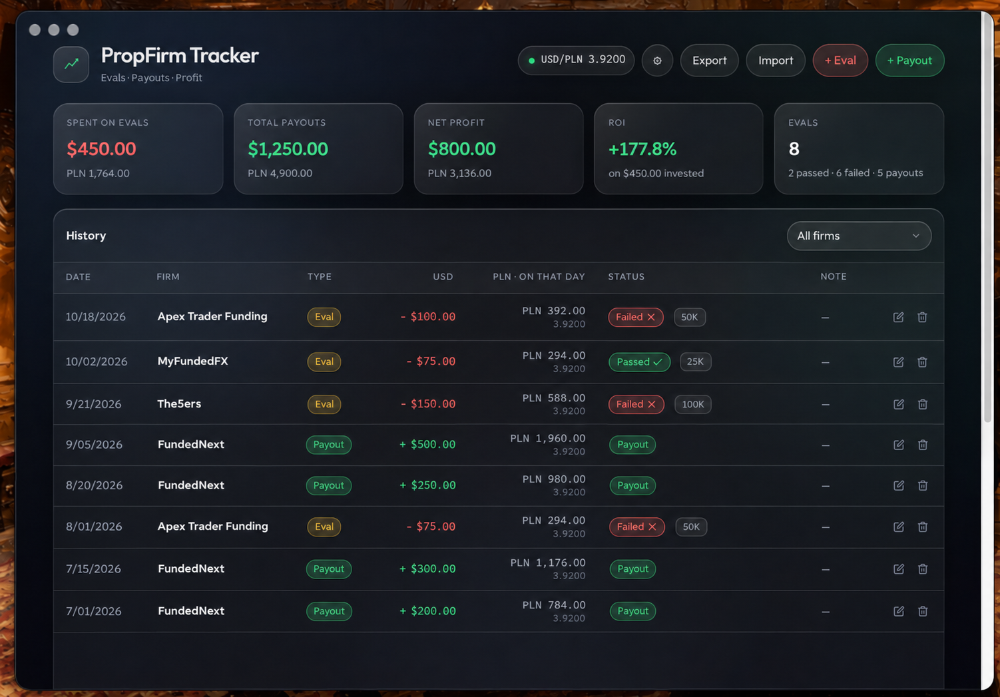

# PropFirm Tracker

Track prop firm **evals**, **payouts**, and **net profit** in a clean dark desktop app — with FX conversion from the **exact date** of each transaction.



## Download

Get the latest installers from **[Releases](https://github.com/Matelko345/PropFirmTracker/releases)**:

| Platform | File |
|----------|------|
| **macOS** (Apple Silicon) | `PropFirm Tracker-1.0.0-arm64.dmg` |
| **Windows** (x64) | `PropFirm Tracker Setup 1.0.0.exe` |

### macOS
1. Open the `.dmg`
2. Drag **PropFirm Tracker** into **Applications**
3. First launch: right‑click → **Open** (unsigned build)

### Windows
1. Run the `.exe` installer
2. Follow the wizard (desktop shortcut optional)
3. If SmartScreen appears: **More info** → **Run anyway**

---

## What it does

- **Evals & payouts** — log costs and withdrawals per prop firm  
- **ROI & net profit** — totals and per‑firm breakdown  
- **FX on transaction day** — pick a date; the app fetches that day’s rate and stores PLN/EUR/… for that entry  
- **Any currency pair** — transaction currency (usually USD) + conversion currency (EUR, PLN, GBP, …)  
- **Polish / English** — switch in ⚙ Settings  
- **Local data** — saved on your device; export/import JSON anytime  

No account. No cloud. Your numbers stay on your machine.

---

## Settings (⚙)

| Setting | Meaning |
|---------|---------|
| **Language** | Polski / English |
| **Transaction currency** | Currency you type amounts in (typically USD) |
| **Conversion currency** | What each row is converted into, using the rate from that row’s date |

Changing conversion currency recalculates history with historical rates.

---

## Develop

```bash
npm install
npm run dev          # browser
npm run dev:app      # Electron window
```

### Build installers

```bash
npm run build:mac    # → release/*.dmg
npm run build:win    # → release/*Setup*.exe
npm run build:app    # mac + windows
```

---

## Privacy

- Runtime data lives in **localStorage** inside the app  
- Published source ships with an **empty** seed (`src/seed.js`) — no personal trades  
- Export JSON before reinstalling if you want a backup  

---

## License

Personal / educational use. Built for traders who want a simple, private prop-firm ledger.
